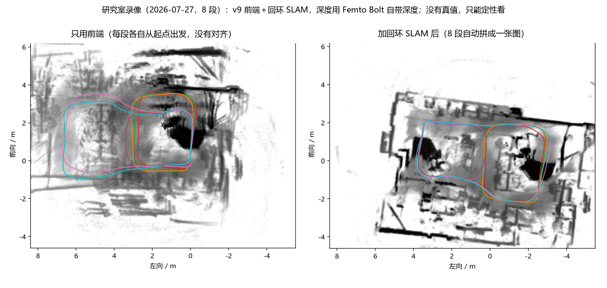
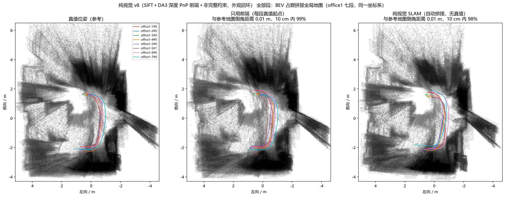
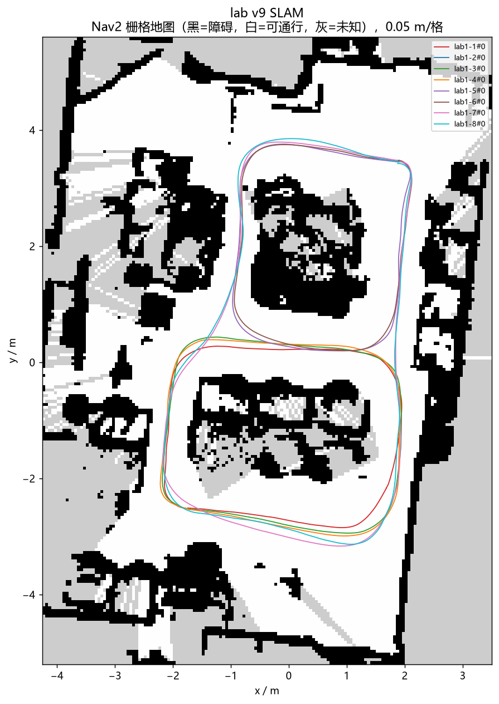
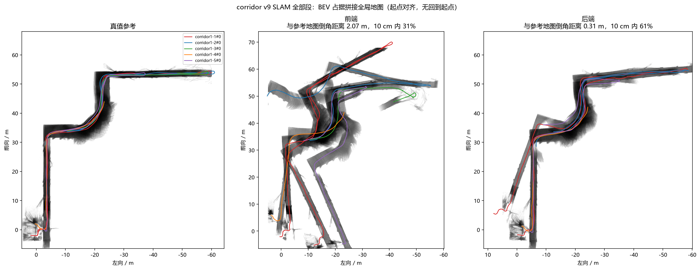

# Monocular Visual SLAM for Mobile Robots / 単眼カメラによる移動ロボットの自己位置推定と地図生成

[日本語](#日本語) | [English](#english)



---

## 日本語

### 概要

単眼カメラ 1 台だけで、移動ロボットの自己位置推定と地図生成（Visual SLAM）を行う研究用コードです。LiDAR や深度センサーを使わず、Nav2 でそのまま使える 2 次元の占有格子地図を作ることを目標にしています。

### 処理の流れ

1. **深度推定**：学習済みの単眼深度推定モデル（Depth Anything 3）で、各フレームの絶対スケールの深度を推定します。
2. **フロントエンド（オドメトリ）**：SuperPoint＋LightGlue（または SIFT）で特徴点をマッチングし、1 枚目の深度で 3 次元化した点から PnP でカメラの動きを求めます。車輪型ロボットの非ホロノミック拘束（横に移動できない）を加えます。
3. **ループ閉じ込み**：DINOv2 の画像特徴で同じ場所を検索し、幾何的に検証したうえで、ロバストな姿勢グラフ最適化を行います。複数回の走行を自動で 1 枚の地図に統合します。
4. **地図出力**：各フレームの深度を鳥瞰図（BEV）に投影して占有格子地図を作り、Nav2 用の PGM＋YAML として書き出します。

研究の初期には、深度画像から作った BEV 上で移動量を推定する深層学習モデル（PyTorch）を開発しました。単眼深度ではフレームごとにスケールが揺らぐため BEV 位置合わせが不利になることを分析し、現在の幾何ベースの構成に移行しました。学習モデル関連のコードもこのリポジトリに含まれています。

### 結果（公開データセット OpenLORIS-Scene）

| 環境 | 入力 | 地図全体の ATE |
|---|---|---|
| office（7 回の走行を統合） | 単眼カメラのみ | 0.20 m |
| cafe（2 回） | 単眼カメラのみ | 0.64 m |
| corridor（5 回中 4 回を統合） | 単眼カメラのみ | 2.99 m |
| market（13 区間中 10 区間を統合） | 単眼カメラのみ | 2.36 m |

ATE は真値軌跡との位置誤差の二乗平均平方根です。office では、学習型 BEV フロントエンドの 0.39 m から 0.20 m に改善しました。



### 研究室の実機データ

研究室の移動ロボット（ROS 2、Orbbec Femto Bolt）で記録した rosbag 8 本を、パラメータを変えずに処理し、1 枚の地図に統合できました。この結果は深度カメラの深度を使ったもので、真値がないため精度は未評価です。



### 現状と課題

- 処理はオフラインです（rosbag を読み込んで後から計算）。実時間で動く ROS 2 ノードは開発予定です。
- 旋回時に前進量がやや小さく推定される問題を調査中です。
- 実機データでの定量評価（LiDAR 軌跡との比較）を準備中です。

---

## English

### Overview

Research code for visual SLAM on a wheeled mobile robot using a **single RGB camera**: no LiDAR or depth sensor at run time. The goal is a metric 2D occupancy grid that Nav2 can use directly.

### Pipeline

1. **Depth**: per-frame metric depth from a pretrained monocular model (Depth Anything 3).
2. **Front end**: SuperPoint + LightGlue (or SIFT) matching, PnP on points lifted with the first frame's depth, plus a nonholonomic (no side-slip) constraint for wheeled robots.
3. **Loop closure**: DINOv2 place retrieval, geometric verification and a robust pose graph; several runs are merged into one map automatically.
4. **Map**: depth projected to a bird's-eye view (BEV) occupancy grid, exported as a Nav2 map (PGM + YAML).

An earlier learned BEV odometry model (PyTorch) is also included. Analysis showed that the frame-to-frame scale jitter of monocular depth hurts BEV registration, which led to the current geometric design.

### Results (OpenLORIS-Scene)

| Scene | Input | Whole-map ATE |
|---|---|---|
| office (7 runs merged) | monocular only | 0.20 m |
| cafe (2 runs) | monocular only | 0.64 m |
| corridor (4 of 5 runs merged) | monocular only | 2.99 m |
| market (10 of 13 segments merged) | monocular only | 2.36 m |



### Lab robot data

Eight rosbags recorded on our lab robot (ROS 2, Orbbec Femto Bolt) were processed with unchanged parameters and merged into one map (top figure). This run used the camera's own depth and has no ground truth, so accuracy is not evaluated.

### Status

- Offline processing of rosbags; a real-time ROS 2 node is future work.
- Investigating a forward-motion underestimate during turns.
- Preparing quantitative evaluation on lab data against a LiDAR trajectory.

---

## Repository layout

```
src/orbbec_bev_odometry/orbbec_bev_odometry/
  multi_scene_pnp.py       monocular depth + PnP front end (SIFT / SuperPoint+LightGlue)
  appearance_slam.py       DINOv2 retrieval, geometric verification, pose graph
  build_global_map.py      BEV occupancy map from a trajectory
  export_nav2_map.py       Nav2 map export (PGM + YAML)
  rosbag_to_sequence.py    ROS 2 bag -> image sequence + calibration
  multi_scene_bev_prep.py  BEV cache for the mapping stage
  keypoint_bev_model.py, train_*.py   learned BEV odometry (earlier work)
  bev_odometry_node.py, pointcloud_odometry_node.py   earlier ROS 2 nodes (depth-camera based)
checkpoints/               trained weights of the learned BEV models
docs/images/               figures used in this README
```

## Typical offline run

```bash
python -m orbbec_bev_odometry.rosbag_to_sequence --bag <bag_dir> --sequence lab1-1 --out-root <root> --depth-root <depth_root>
python -m orbbec_bev_odometry.multi_scene_pnp --dataset-root <root> --da3-root <depth_root> --sequences lab1-1 --matcher superpoint_lightglue --output-dir <out>
python -m orbbec_bev_odometry.appearance_slam --input <out>/lab1-1/predictions.csv <manifest.jsonl> --dataset-root <root> --depth-source da3 --da3-root <depth_root> --model-dir <dinov2-base> --output-dir <slam_out>
python -m orbbec_bev_odometry.export_nav2_map --trajectories <slam_out>/trajectories.csv --output-dir <nav2_out>
```

Main dependencies: Python 3, PyTorch, OpenCV, NumPy, SciPy, LightGlue, Hugging Face Transformers (DINOv2), rosbags. Depth Anything 3 is run separately to produce per-frame depth.

## Acknowledgements

OpenLORIS-Scene dataset; Depth Anything 3; SuperPoint and LightGlue; DINOv2; BEV-DWPVO (used as a reference baseline).
